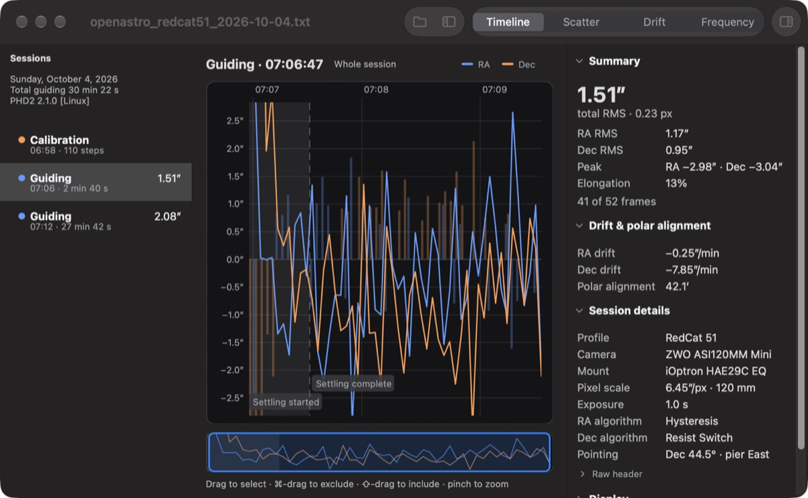
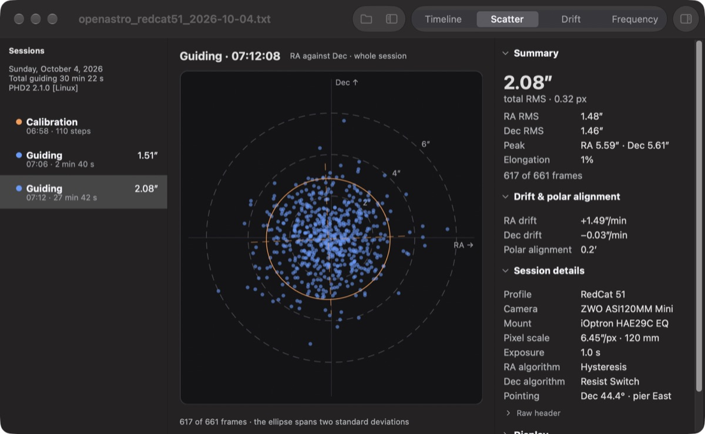
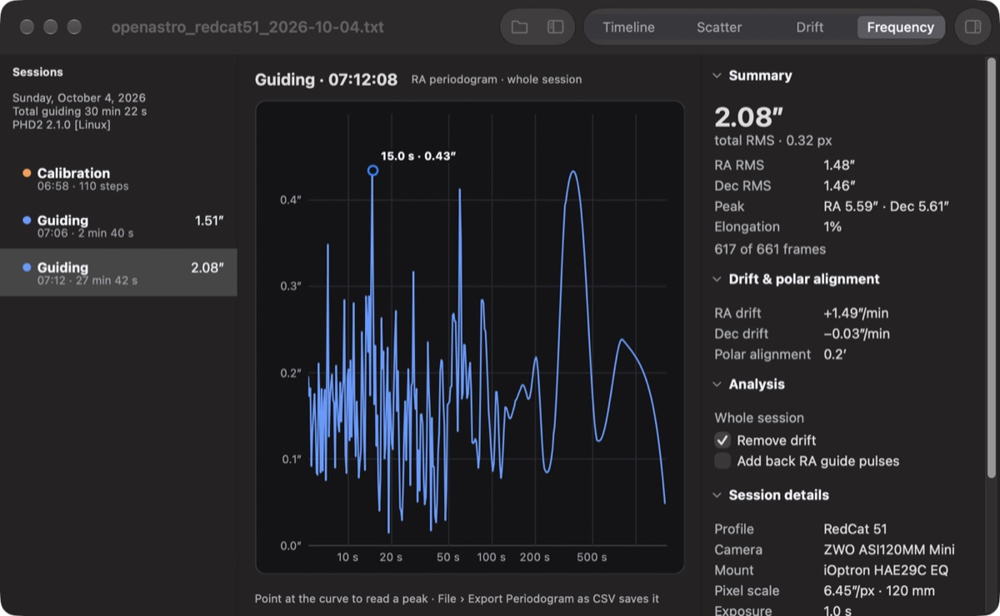
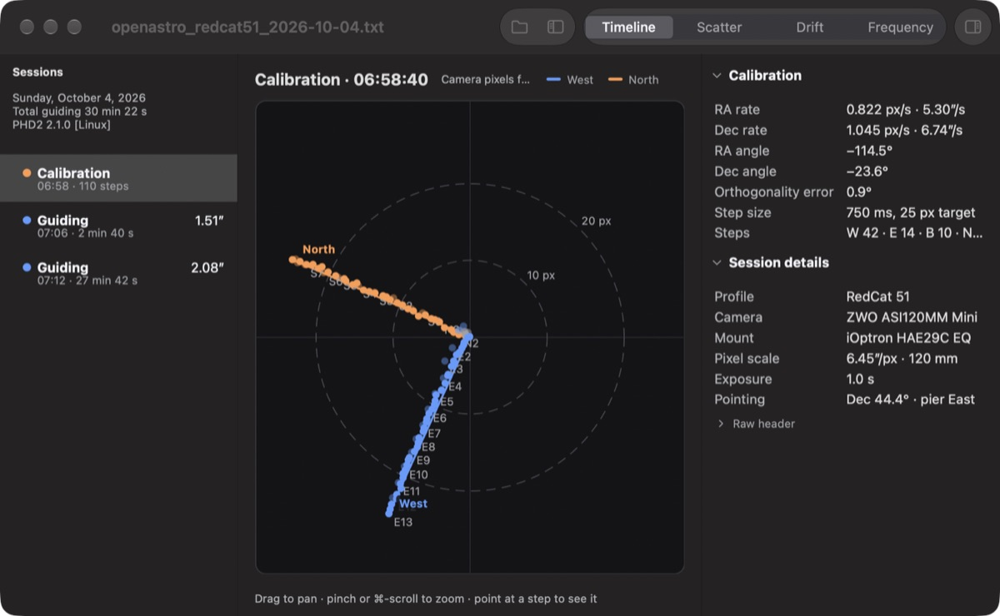

# OpenAstro Guide Insight

[](https://github.com/open-astro/openastro-guide-insight/actions/workflows/ci.yml)

See and analyze your [PHD2](https://openphdguiding.org) guide logs on Windows, macOS and Linux.



Open a `PHD2_GuideLog_*.txt` file to:

- Browse every calibration and guiding session in the log.
- Plot RA/Dec error, guide pulses, star mass and SNR over time, by frame or by clock time, with dithers, settling and other events marked.
- Get RMS, peak, elongation, drift and polar alignment error for a session or any part of it: drag across the chart to select frames.
- Exclude settling, server pauses or any range you choose from the statistics.
- See the scatter of RA against Dec with scale rings and the elongation ellipse.
- Analyze a selection, a Guiding Assistant run or a whole session for drift and periodic error, and export the periodogram as CSV.
- Check a calibration's steps, rates, angles and orthogonality.

| Scatter | Frequency | Calibration |
|---|---|---|
|  |  |  |

## Download

Get the latest build from [Releases](https://github.com/open-astro/openastro-guide-insight/releases):

| Platform | File |
|---|---|
| Windows 10/11, x64 or ARM64 | `openastro-guide-insight-<version>-windows-<arch>-setup.exe` |
| macOS 26 or later, Apple Silicon | `openastro-guide-insight-<version>-macos-arm64.dmg` |
| Linux, x86_64 or aarch64 (glibc 2.35 or newer) | `openastro-guide-insight-<version>-linux-<arch>.AppImage` |

The downloads are not signed yet, so the first launch needs a nudge:

- **macOS:** open the app once, then in System Settings › Privacy & Security choose Open Anyway.
- **Windows:** in the SmartScreen prompt, choose More info, then Run anyway.
- **Linux:** make the AppImage executable (`chmod +x`), then run it.

## Using it

Choose **File › Open**, or drag a log onto the window. PHD2 writes its logs to Documents/PHD2 by default.

- The **sidebar** lists the log's sessions. The **toolbar** switches the chart between Timeline, Scatter, Drift and Frequency.
- The **inspector** on the right shows the statistics, the session's equipment and settings, display options, and the exclusion rules.
- On the Timeline, scroll to pan, and pinch or ⌘/Ctrl-scroll to zoom. Drag to select frames; ⌘/Ctrl-drag excludes them and Shift-drag includes them.

**Help › OpenAstro Guide Insight Help** describes every view and gesture.

## Building from source

You need CMake 3.24+, Ninja, a C++20 compiler and [vcpkg](https://vcpkg.io).

**macOS (Apple Silicon)**

```
export VCPKG_ROOT=~/vcpkg
cmake --preset macos-arm64
cmake --build --preset macos-arm64
ctest --preset macos-arm64
scripts/make-dmg.sh "out/build/macos-arm64/OpenAstro Guide Insight.app" guide-insight.dmg
```

**Windows** (from a Developer Command Prompt)

```
set VCPKG_ROOT=C:\vcpkg
cmake --preset win-x64        :: or win-arm64
cmake --build --preset win-x64
ctest --preset win-x64
```

To make the installer, install the build into a folder and run [Inno Setup 6](https://jrsoftware.org/isinfo.php) on the script CMake generates:

```
cmake --install out/build/win-x64 --prefix stage
ISCC /DArch=x64 /DSourceDir=%CD%\stage out\build\win-x64\openastro-guide-insight.iss
```

**Linux**

Install GTK 3, GSL and the other build dependencies, build the pinned wxWidgets, then configure against it:

```
sudo apt install ninja-build libgtk-3-dev libgsl-dev libpcre2-dev zlib1g-dev libpng-dev libjpeg-dev libtiff-dev libexpat1-dev
scripts/build-wxwidgets.sh ~/wx
cmake --preset linux -DCMAKE_PREFIX_PATH=$HOME/wx
cmake --build --preset linux
ctest --preset linux
DESTDIR=$PWD/stage cmake --install out/build/linux --prefix /usr
scripts/make-appimage.sh stage x86_64 "$(cat out/build/linux/version.txt)" guide-insight.AppImage
```

The app uses wxWidgets **3.2.12**, pinned on every platform until wxWidgets 3.4. See [`vcpkg-ports/README.md`](vcpkg-ports/README.md).

## Contributing

See [CONTRIBUTING.md](CONTRIBUTING.md). Changes are made test-first, and CI builds and tests every platform.

## Credits

OpenAstro Guide Insight is a fork of [PHD2 Log Viewer](https://github.com/agalasso/phdlogview) by Andy Galasso, which is no longer maintained. Thank you, Andy, for the original app.

## License

OpenAstro Guide Insight is free software under the GNU General Public License, version 3 or later (GPL-3.0-or-later). See [LICENSE.txt](LICENSE.txt). Copyright (C) 2016-2020 Andy Galasso, (C) 2026 OpenAstro contributors.

It is built with:

| Library | Use | License |
|---|---|---|
| [wxWidgets](https://www.wxwidgets.org) 3.2 | Windows, controls and drawing | wxWindows Library Licence 3.1 |
| [GNU Scientific Library](https://www.gnu.org/software/gsl/) | Splines and the FFT for the periodogram | GPL-3.0-or-later |
| [Catch2](https://github.com/catchorg/Catch2) 3 | Tests only; not shipped | BSL-1.0 |

The Linux AppImage also bundles GTK 3 and its dependencies, under their own (mostly LGPL) licenses.
